# Guia do Montador

O Montador monta as sequências das videoaulas no Premiere. Você escolhe a pasta do dia da gravação, e ele
separa as aulas, marca os erros e bastidores (pela Skoopia ou pelas regras do Fluxo NPD), coloca os slides
nos pontos de inserção e entrega um XML pronto para importar no Premiere. No fim, gera também as thumbs
das aulas.

**Nada é apagado:** erros e bastidores entram como marcadores coloridos na timeline, e quem decide o corte
é o editor. Tudo roda no seu computador.

**Neste guia**
1. [Baixar e instalar](#1-baixar-e-instalar)
2. [Primeira vez: arquivos do projeto](#2-primeira-vez-arquivos-do-projeto)
3. [O dia a dia em 7 passos](#3-o-dia-a-dia-em-7-passos)
4. [O que vem na sequência](#4-o-que-vem-na-sequência)
5. [Thumbs das aulas](#5-thumbs-das-aulas)
6. [Configurações](#6-configurações)
7. [Atualizar o app](#7-atualizar-o-app)
8. [Problemas comuns](#8-problemas-comuns)

---

## 1. Baixar e instalar

O app fica na página **Releases** do GitHub. Não precisa ter conta no GitHub para baixar.

**Links diretos (sempre a versão oficial mais nova):**
- **Mac:** https://github.com/jprodriguesgm/montador/releases/latest/download/Montador-mac.zip
- **Windows:** https://github.com/jprodriguesgm/montador/releases/latest/download/Montador-windows.zip

Basta clicar: o download começa sozinho (Mac: cerca de 330 MB; Windows: cerca de 540 MB, porque o
LibreOffice e as fontes já vão dentro). Guarde esses dois links: eles não mudam quando sai uma versão nova.

> Versões chamadas **"Montagem N (teste)"**, marcadas como **Pre-release**, são de teste e ainda não foram
> liberadas. Use sempre a que tem a etiqueta **Latest** (ou os links diretos acima).

### Mac

Funciona em Mac com chip Apple (M1, M2, M3, M4…), macOS 11 ou mais novo. Mac com processador Intel não
funciona.

1. Dê dois cliques no `Montador-mac.zip`. Aparece o **Montador**.
2. Arraste o app para a pasta **Aplicativos** (ou para `~/Applications`, se não tiver senha de
   administrador, ou qualquer pasta sua).
3. **Só na primeira vez de cada versão:** o app não tem assinatura da Apple, então o Mac bloqueia. Abra o
   **Terminal** (Spotlight → "Terminal") e cole (troque o caminho se o app ficou em outro lugar; dá para
   arrastar o app para dentro do Terminal):

       xattr -dr com.apple.quarantine /Applications/Montador.app

4. Dois cliques no app: a página abre no navegador. O app **não aparece no Dock**; ele vive na página.
   Fechou a aba, ele fecha sozinho uns minutos depois.
5. Na primeira vez que você escolher uma pasta (disco externo, Mesa, Documentos), o Mac pergunta se o
   Montador pode acessar. Responda **Permitir**.

### Windows 10/11 (64 bits)

1. Clique com o botão direito no `Montador-windows.zip` → **Propriedades** → marque **Desbloquear** →
   **OK**.
2. Botão direito → **Extrair tudo…** para uma pasta sua, por exemplo `Documentos\Montador`. Não use
   "Arquivos de Programas", que pede administrador.
3. Dois cliques em **Montador.exe**. Se aparecer "O Windows protegeu o computador":
   **Mais informações** → **Executar assim mesmo** (só na primeira vez).
4. A página abre no navegador.

**Se o antivírus acusar vírus:** é alarme falso (o app não tem assinatura digital paga). Não desative o
antivírus por conta própria no computador do trabalho: fale com a TI, que pode liberar o app (o código é
aberto e está neste repositório). O app não usa o PowerShell.

---

## 2. Primeira vez: arquivos do projeto

Na primeira vez em cada computador, o app avisa no topo que falta apontar os arquivos da vinheta, brasão e
fundos.

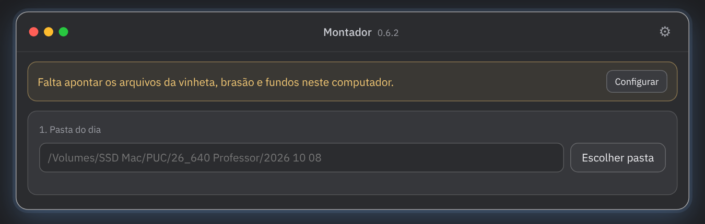

Clique em **Configurar** (ou na engrenagem ⚙ no canto). Em **Arquivos dos projetos**, clique em
**Procurar** em qualquer um (por exemplo, a vinheta `Final_cima_v4_mov.mov`). O app procura os outros
sozinho na mesma estrutura de pastas, como o **Link Media** do Premiere. Os que ele achar ficam **ok**.

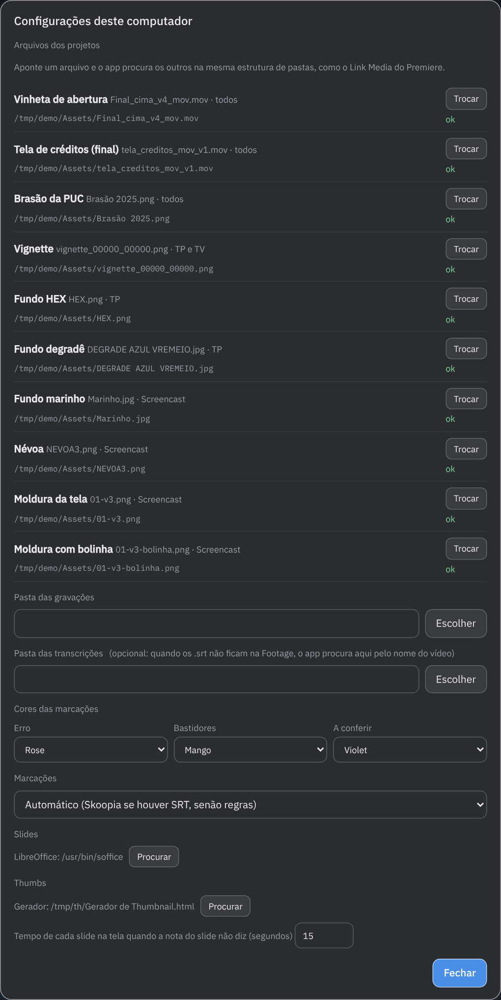

| Arquivo | Usado em |
|---|---|
| Vinheta de abertura, tela de créditos, brasão | todos os formatos |
| Vignette | TP e TV |
| Fundo HEX e fundo degradê | TP |
| Fundo marinho, névoa, molduras | Screencast |

Ainda nas Configurações (dá para deixar para depois):
- **Thumbs:** aponte o `index.html` do **gerador de thumbnail** da equipe (a fonte e as artes vêm dele;
  [seção 5](#5-thumbs-das-aulas)).
- **Slides:** mostra o LibreOffice que converte os slides. No app ele já vai dentro; não precisa mexer.

---

## 3. O dia a dia em 7 passos

A tela é uma página só, de cima para baixo. Cada caixa é um passo.

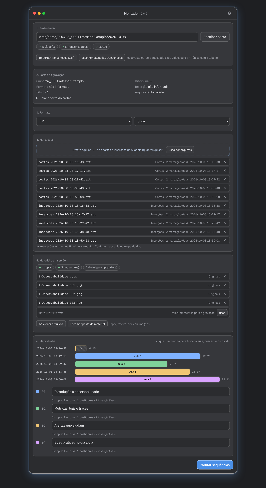

### Passo 1 — Pasta do dia

Clique em **Escolher pasta** e escolha a pasta do dia da gravação (a que tem a `Footage`), ou cole o
caminho no campo. O app mostra quantos vídeos, transcrições e se achou o cartão.

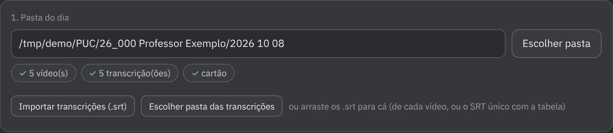

- **Transcrições:** o app procura os `.srt` do `transcribe` na Footage (de cada vídeo ou o SRT único do
  dia). Se elas estiverem em outra pasta, use **Importar transcrições** ou **Escolher pasta das
  transcrições**, ou arraste os `.srt` para a caixa.
- **Transcrição master:** se a transcrição foi feita no Premiere, com todos os vídeos do dia colados um
  depois do outro (na ordem dos nomes), é só pôr o `.srt` na Footage ou importar: o app divide pela
  duração de cada vídeo. Os SRTs da Skoopia feitos sobre ela também são divididos sozinhos.
  - Se o app não reconhecer sozinho, marque **Transcrição feita no Premiere (vídeos em sequência)**: a
    transcrição que já foi importada é dividida na hora, sem importar de novo.
  - Mais exato: **Importar XML da sequência master** (no Premiere, selecione a sequência e use
    **Arquivo → Exportar → Final Cut Pro XML**). O XML diz onde cada vídeo começa de verdade: aguenta
    espaço entre os vídeos, ordem diferente da dos nomes, vídeo cortado no começo e vídeo que não é do dia.
  - Se o app não conseguir ler a duração de algum vídeo, ele diz **qual** — o XML resolve nesse caso.
- Vídeo sem transcrição não monta: rode o `transcribe` na pasta antes.

### Passo 2 — Cartão da gravação

O app lê o cartão (`.txt` na pasta Originais) com curso, formato, tipo de inserção e os **títulos das
aulas**. Se não houver, abra **Colar o texto do cartão** e cole o texto do cartão do Planner/Trello (ou só
os títulos, um por linha).

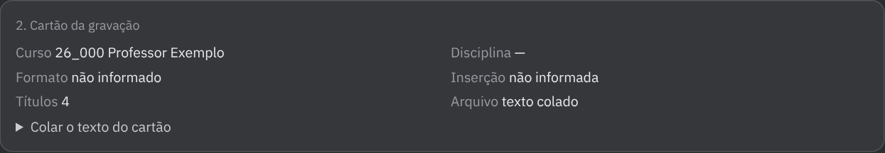

Os títulos são das aulas gravadas **naquele dia**, na ordem. Eles viram o nome das sequências
("01 Título", "02 Título"…).

### Passo 3 — Formato

Confira o formato (**TP**, **TV** ou **Screencast**) e o tipo de inserção. O app já preenche pelo cartão.

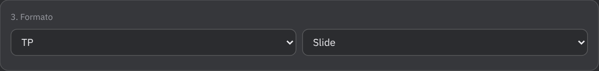

| Inserção | O que o app faz |
|---|---|
| Slide | coloca os slides do professor nos pontos de inserção |
| Palavra-chave | gera as cartelas de palavra-chave |
| Slide e palavra-chave | as duas coisas |
| A critério do editor | só marcadores |
| Sem inserção | nada |

### Passo 4 — Marcações (Skoopia)

Arraste para a caixa os SRTs de **cortes** e de **inserções** que a Skoopia devolveu, quantos forem (ou
**Escolher arquivos**). O app reconhece cada um pelo conteúdo e liga ao vídeo certo:
- pelo nome do arquivo, quando ele traz o nome do vídeo;
- quando vêm do **SRT único** ou da **transcrição master do Premiere**, ele divide sozinho por vídeo;
- senão, compara as falas citadas com a transcrição de cada vídeo.

Depois de dividir, o app confere: se as falas citadas não batem com a transcrição naqueles tempos, ou se o
arquivo passa do fim da sequência, ele avisa (**ATENÇÃO**) — pode ser de outro dia. Quando não dá para
saber o vídeo, ele diz o motivo e pede para você escolher. O que chegar depois (o XML, a transcrição) faz
os SRTs da Skoopia já importados se dividirem de novo, sem precisar arrastar outra vez.

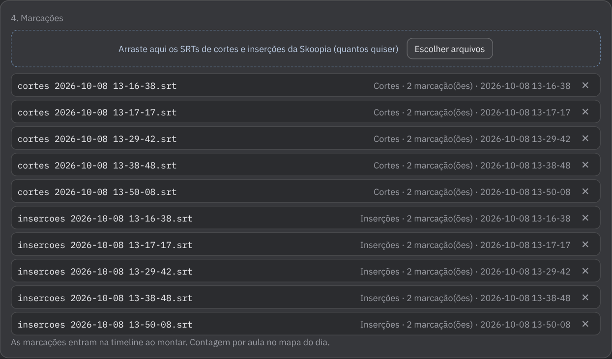

Sem a Skoopia, deixe a caixa vazia: o app marca erros e bastidores pelas **regras do Fluxo NPD** (sem IA).
Dá para trocar isso nas Configurações (**Marcações**).

Com a Skoopia, o app pode usar **também o script** (as regras sem IA): o que só ele achar entra como
**PODE SER UM ERRO**, em outra cor, para o editor conferir. Nada é cortado. Liga e desliga na janela de
**Montar** (fica lembrado).

### Passo 5 — Material de inserção

O app procura os slides (`.pptx`), roteiros (`.docx`) e imagens na pasta do dia.
- **Adicionar arquivos** (segure Cmd/Ctrl para escolher vários) ou **Escolher pasta do material** se
  estiverem em outro lugar.
- **✕** tira um arquivo da montagem; **usar** traz de volta.
- Arquivos que começam com **TP** (`TP-aula-17.pptx`) são do **teleprompter**: ficam de fora sozinhos.

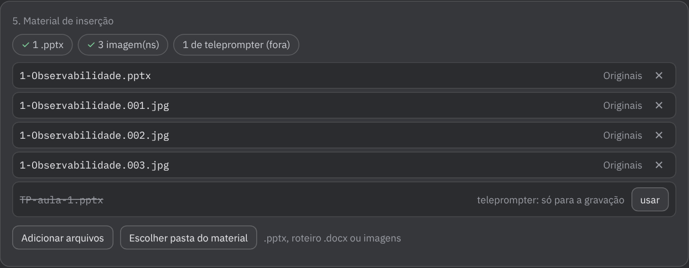

Os slides viram JPEG 1920x1080 na hora de montar, numa pasta com o nome do `.pptx`. Se você já exportou
os JPEG nessa pasta, o app usa os seus.

### Passo 6 — Mapa do dia

O mapa mostra cada vídeo do dia e a qual aula cada pedaço pertence. **Os títulos do cartão mandam:** cada
título é uma aula, na ordem do dia, e o app procura o trecho de cada uma. Ele tira os testes de câmera e os
arquivos minúsculos sem aula ("vou parar cinco minutinhos"), percebe o take descartado, o final refeito em
outro vídeo e a aula que continua no vídeo seguinte.

Para achar onde começa cada aula, o app soma pistas — nenhuma decide sozinha: o "Olá" e o "vejo vocês"
na fala; a conta dos títulos; aberturas como "Neste vídeo…"/"Nesta aula…" e a síntese no fim da aula
anterior; o texto dos slides de cada aula (`.pptx`, na ordem dos nomes: U3_T1_V1, U3_T1_V2…) e das
inserções da Skoopia, comparado com o que é falado; e a duração. Sem cartão, ele só separa uma aula sem
"Olá" quando há pelo menos duas pistas fortes.

- **Aula não reconhecida:** o título que não achou trecho com segurança aparece em laranja, com
  **escolha o trecho** — escolha na lista e pronto. Ela não vira sequência enquanto não tiver trecho, e
  as outras aulas **não** mudam de número (aula 9 continua sendo o 9º título).
- **Pausa longa** (5 minutos ou mais sem fala no meio de um vídeo) fica marcada para conferir: às vezes o
  começo antes da pausa é um take descartado.

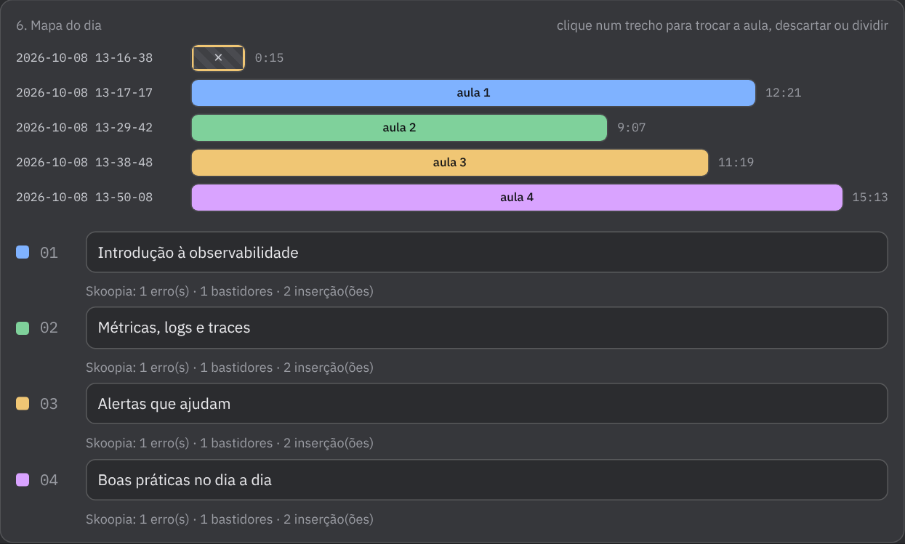

Clique num trecho para:
- trocar a aula dele (ou **Descartar**: teste, take ruim, conversa);
- **Dividir** o trecho num tempo (mm:ss), quando duas aulas estão no mesmo vídeo.

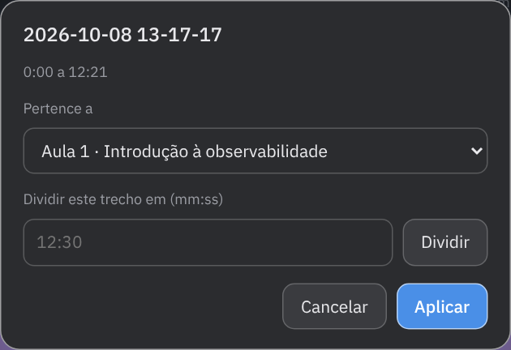

Embaixo, cada aula mostra o título (dá para editar) e quantos erros, bastidores e inserções caem nela.

### Passo 7 — Montar

Clique em **Montar sequências**. Escolha onde salvar (o padrão é a pasta `Projeto` do dia) e se quer
**um XML só com todas as aulas** (recomendado: uma importação no Premiere, e a vinheta e os vídeos entram
uma vez só).

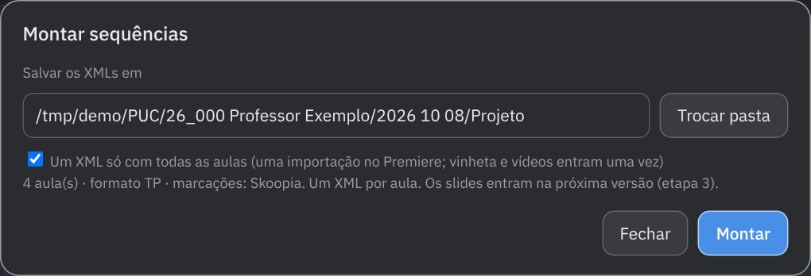

No fim, a janela mostra o que saiu em cada aula, os avisos e o **relatório** (um `.txt` salvo junto, para
mandar se algo der errado).

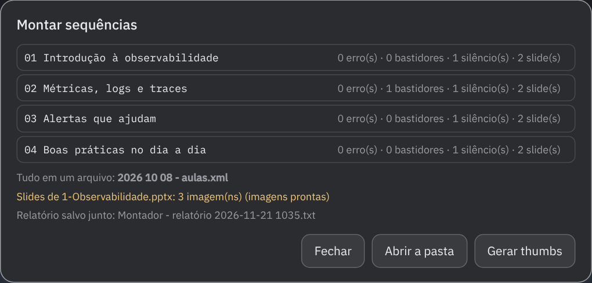

No Premiere: **Arquivo → Importar** o XML. Cada aula vira uma sequência.

---

## 4. O que vem na sequência

- **Sem efeitos:** nada de Lumetri nem desfoque; só movimento, corte, opacidade e áudio.
- **Vinheta, fundos, brasão e créditos** nos lugares de sempre, de cada formato.
- **Marcadores coloridos** (as cores dá para trocar nas Configurações):

| Marcador | O que é |
|---|---|
| **ERRO** (Rose) | o professor errou e refez: confira e corte |
| **BASTIDORES** (Mango) | conversa com a equipe, ajuste, troca de arquivo |
| **SILÊNCIO** | pausa de 8 s ou mais |
| **A CONFERIR** (Violet) | o app não teve certeza |
| **PODE SER UM ERRO** (Cerulean) | com a Skoopia: o script achou e a IA não marcou |
| **SLIDE C33** | onde entrou um slide (com o porquê no comentário) |
| **CARTELA** | inserção sem slide do professor: criar a cartela |
| **TELA CHEIA** (TV) | a tela da TV em tela cheia |
| **TROCA DE VÍDEO** | a aula continua em outra gravação: confira a emenda |
| **Lower Third** | onde entra a tarja com o nome do professor |

- **TP:** o slide entra na V7, pelo tempo que a nota do slide pede ("Exibir por 6 a 8 segundos" → 8 s) ou
  15 s.
- **TV:** no ponto de inserção, a tela da TV entra em tela cheia numa faixa por cima.
- **Screencast:** só os cortes.
- **Aula em mais de um vídeo:** sai numa sequência só, uma parte depois da outra, com o marcador
  **TROCA DE VÍDEO** na emenda.

---

## 5. Thumbs das aulas

Depois de montar, clique em **Gerar thumbs**. A janela já abre com os títulos das aulas e uma prévia de
cada thumb, no padrão do gerador de thumbnail da equipe (mesma fonte, mesmas artes, mesma regra do
tamanho da letra).

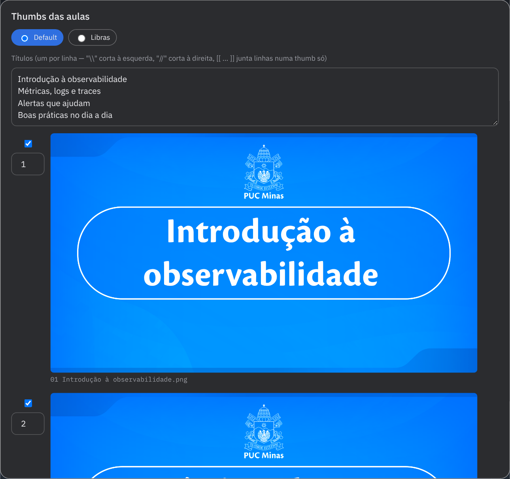

- **Default** ou **Libras** no topo.
- Regras de barra, iguais às do gerador: `\\` corta o que vem à esquerda, `//` corta o que vem à direita,
  e `[[ ... ]]` junta várias linhas numa thumb só.
- Dá para editar o texto direto na prévia, desmarcar uma thumb ou trocar o número.
- **Confirmar e salvar** cria a pasta `Saída` no dia (dá para trocar) com PNG 1920x1080 e o nome das
  sequências (`01 Título.png`).

A fonte das thumbs é licenciada e não vai no app: ele lê a fonte e as artes do `index.html` do gerador,
apontado nas Configurações. Se o gerador mudar as artes, o Montador usa as novas sozinho.

---

## 6. Configurações

Engrenagem ⚙ no canto da janela. Tudo fica guardado **neste computador**.

- **Arquivos dos projetos:** vinheta, créditos, brasão, fundos ([seção 2](#2-primeira-vez-arquivos-do-projeto)).
- **Pasta das gravações:** onde a janela de escolher a pasta do dia começa.
- **Pasta das transcrições:** quando os `.srt` não ficam na Footage, o app procura aqui pelo nome do vídeo.
- **Cores das marcações:** erro, bastidores, a conferir e pode ser um erro (cores de rótulo do Premiere).
- **Marcações:** Automático (Skoopia se houver SRT, senão regras), Sempre Skoopia ou Sempre sem IA.
- **Slides:** o LibreOffice usado e o tempo padrão de cada slide na tela.
- **Thumbs:** o `index.html` do gerador de thumbnail.
- **Versões de teste:** o botão Atualizar oferece também as montagens de teste (só para quem testa).

---

## 7. Atualizar o app

Quando sai uma versão nova, aparece no topo da janela **"Montador X disponível"** com dois botões:
- **Atualizar:** o app baixa a versão nova, fecha, troca a si mesmo e abre de novo numa janela nova. Não
  precisa de administrador nem do comando `xattr` (o arquivo baixado pelo próprio app não fica bloqueado).
  - **Mac:** se não der para trocar o app na pasta onde ele está, o novo vai para a pasta **Aplicativos do
    usuário** (`~/Applications`) e o app avisa.
  - **Windows:** se não der para trocar na pasta atual, o novo vai para
    `%LOCALAPPDATA%\Programs\Montador` e o app avisa (troque o atalho).
- **Baixar:** só baixa o `.zip` para a pasta **Downloads** e abre a pasta — para trocar à mão, como antes.

Se a troca automática esbarrar em alguma permissão, o app avisa e deixa o `.zip` em Downloads. Sem os
botões (ou numa versão antiga), atualize à mão:
1. Baixe de novo pelo link direto da [seção 1](#1-baixar-e-instalar).
2. Troque o app antigo pelo novo (Mac: arraste por cima; Windows: extraia por cima ou numa pasta nova).
3. **Mac:** repita o comando `xattr` (cada versão nova baixada pelo navegador vem bloqueada de novo).

Quem testa as novidades antes da equipe pode marcar, nas Configurações, **Receber também as versões de
teste no botão Atualizar**.

Se a versão antiga ainda estiver aberta, a nova fecha a antiga sozinha ao abrir. As configurações ficam
**fora** do app, então atualizar não apaga nada. A versão aparece no topo da janela, ao lado do nome.

---

## 8. Problemas comuns

- **O Mac diz que o app "está danificado" ou "não pode ser aberto":** faltou o comando `xattr`.
- **"Falta apontar os arquivos da vinheta…":** aponte um deles em Configurações; o app acha os outros.
- **A aula saiu sem slides e com CARTELA em tudo:** o relatório diz se o app achou os `.pptx` ("Slides
  de …"). Confira a caixa Material e monte de novo.
- **O mapa juntou ou separou aulas errado:** clique no trecho e troque a aula, descarte ou divida.
  Confira também se o número de títulos do cartão bate com as aulas gravadas. Se alguma aula ficou
  **não reconhecida**, escolha o trecho dela na lista embaixo do mapa.
- **"Parece a transcrição da sequência master, mas…":** marque **Transcrição feita no Premiere** ou importe
  o XML da sequência (passo 1). O aviso diz qual vídeo ficou sem duração, quando for o caso.
- **Vídeo "sem transcrição":** rode o `transcribe` na pasta do dia, ou importe os `.srt` no passo 1.
- **Arquivo da Skoopia "pendente":** o app não soube de qual vídeo é. Escolha o vídeo na lista, ou
  importe o SRT único do dia (com ele, a divisão é exata).
- **Algo estranho aconteceu:** mande o **relatório** (`Montador - relatório ….txt`, salvo junto com os
  XMLs). O registro do app fica em `montador.log`:
  - Mac: `~/Library/Application Support/Montador`
  - Windows: `%APPDATA%\Montador`

Para conferir se tudo está dentro do app:
- Mac (Terminal): `/Applications/Montador.app/Contents/MacOS/Montador diagnostico`
- Windows (Prompt de Comando, dentro da pasta do app): `montador-terminal.exe diagnostico`
