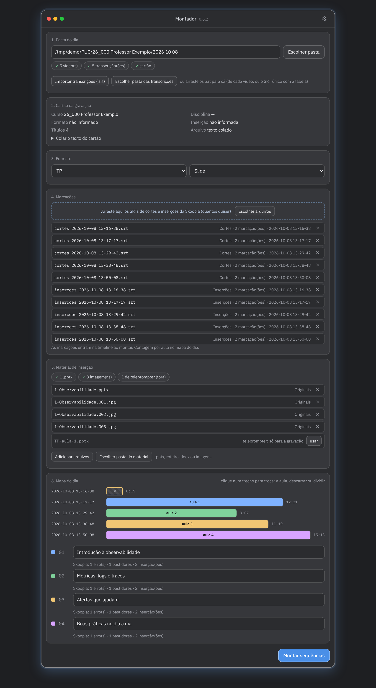

# Montador

App que monta as sequências das videoaulas no Premiere. A partir da pasta do dia da gravação, ele separa
as aulas (mapa do dia), marca erros e bastidores (pela **Skoopia** ou pelas regras do Fluxo NPD, sem IA),
coloca os slides do professor nos pontos de inserção e entrega um XML pronto para importar no Premiere,
nos formatos **TP**, **TP com palavra-chave**, **TV** e **Screencast**. No fim, gera as **thumbs** das aulas
no padrão da equipe. Nada é apagado: os cortes entram como marcadores, e quem decide é o editor.

Feito no Núcleo de Produção Digital da PUC Minas para o fluxo de videoaulas da pós-graduação. Substitui o
Fluxo NPD.

## Baixar

| | Link direto (sempre a versão oficial mais nova) |
|---|---|
| **Mac** (chip Apple M1 ou mais novo, macOS 11+) | [Montador-mac.zip](https://github.com/jprodriguesgm/montador/releases/latest/download/Montador-mac.zip) |
| **Windows** 10/11 (64 bits) | [Montador-windows.zip](https://github.com/jprodriguesgm/montador/releases/latest/download/Montador-windows.zip) |

**Como instalar e usar: [GUIA.md](GUIA.md)** (passo a passo com imagens).

Todas as versões: [Releases](https://github.com/jprodriguesgm/montador/releases). Versões
"Montagem N (teste)" são de teste; a oficial é a marcada como **Latest**.

## Para a TI: privacidade e segurança

- **Nada sai do computador.** O app abre um servidor local que só escuta em `127.0.0.1` e mostra a tela
  no navegador. Vídeos, transcrições, slides e SRTs são lidos no próprio computador.
- **Sem internet e sem IA online no app.** A Skoopia é usada à parte, pela equipe; o Montador só lê os
  SRTs que ela devolve. Sem a Skoopia, ele marca pelas regras do Fluxo NPD.
- **Não pede administrador e não instala nada no sistema.** O LibreOffice (para converter os slides) e as
  fontes vão dentro do app. As configurações ficam numa pasta do usuário:
  `~/Library/Application Support/Montador` (Mac) ou `%APPDATA%\Montador` (Windows).
- **O app não tem assinatura da Apple nem da Microsoft.** Por isso o Mac pede o comando `xattr` na
  primeira abertura e o Windows mostra "O Windows protegeu o computador". O app do Windows não usa o
  PowerShell.
- **Montagem rastreável.** Cada versão é montada pelo GitHub Actions a partir deste código
  ([.github/workflows/montar.yml](.github/workflows/montar.yml)), com testes e diagnóstico publicados na
  página de cada versão. O LibreOffice vem do site oficial e as fontes, dos repositórios oficiais
  ([packaging/build_deps.py](packaging/build_deps.py)).
- O repositório guarda **só código**: nenhum vídeo, transcrição real, slide de professor ou fonte
  licenciada. Os dados de teste são fictícios.

## Licença

Copyright (C) 2026 João Paulo Rodrigues.

Software livre: você pode redistribuir e modificar sob os termos da **GNU General Public License,
versão 3 ou posterior** ([LICENSE](LICENSE)). Sem garantia de qualquer tipo.
Os programas e dados de terceiros que vão dentro do app e as licenças de cada um estão em
[LICENCAS-DE-TERCEIROS.md](LICENCAS-DE-TERCEIROS.md).

## Para quem programa

Python (biblioteca padrão) + Pillow e pypdfium2; tela em HTML/CSS/JS puro servida pelo próprio Python. Os
geradores de XML do Fluxo NPD ficam em `montador/motor` e rodam dentro do app. As decisões do projeto
estão em [DESENHO.md](DESENHO.md).

| Parte | Onde |
|---|---|
| Pasta do dia, transcrições, material | `montador/dia.py` |
| Cartão (títulos, formato, inserção) | `montador/cartao.py` |
| Mapa do dia (aulas, takes, trechos) | `montador/mapa.py` |
| SRTs da Skoopia (cortes, inserções, SRT único) | `montador/skoopia.py` |
| Montagem (geradores, pós-processo, relatório) | `montador/montagem.py` |
| Slides (.pptx → JPEG) e inserções na timeline | `montador/slides.py`, `montador/insercoes.py` |
| XML único do dia e aula em mais de um vídeo | `montador/juntar.py` |
| Thumbs (padrão do gerador da equipe) | `montador/thumbs.py`, `montador/ui/thumbs.js` |
| Servidor e tela | `montador/server.py`, `montador/ui/` |

### O que precisa
- Python 3.10+ com `Pillow` e `pypdfium2` (`requirements.txt`).
- LibreOffice para converter os slides (no app, vai dentro; para testar, o do sistema serve; no Mac sem
  LibreOffice, o Keynote).
- Só para os testes: `pytest` e `python-pptx`.

### Abrir pelo código
    python3 -m montador                          # abre a tela no navegador (servidor só em 127.0.0.1:8767)
    python3 -m montador abrir --sem-navegador --porta 8767
    python3 -m montador mapa "/caminho/da/pasta do dia"   # mapa sugerido, no Terminal
No Mac, dois cliques em `Abrir Montador.command`. As configurações ficam em
`~/Library/Application Support/Montador` (Mac) ou `%APPDATA%\Montador` (Windows); a variável
`MONTADOR_HOME` troca essa pasta.

### Montar o app
GitHub → aba **Actions** → "Montar o app" → **Run workflow**. Com o campo **Versão oficial** vazio sai uma
versão de **teste** ("Montagem N (teste)", pré-lançamento). Com `1.1.0` no campo (ou uma etiqueta `v1.1.0`)
sai a versão **oficial**, que o link `releases/latest` entrega. Os zips têm nome fixo: `Montador-mac.zip` e
`Montador-windows.zip`. Para limpar as versões de teste: Actions → "Arquivar versões de teste".
Na mão (no próprio sistema):

    python packaging/build_deps.py      # fontes/ e bin/ (LibreOffice)
    pip install -r requirements.txt pyinstaller
    pyinstaller --noconfirm packaging/montador.spec      # dist/

`Montador diagnostico [slides.pptx]` confere se tudo está dentro do app. O ícone sai de
`tools/fazer_icone.py`.

### Testar
    python3 -m pytest -q tests
    python3 tools/comparar_fluxo.py      # modo sem IA: mesmo XML que o Fluxo NPD
